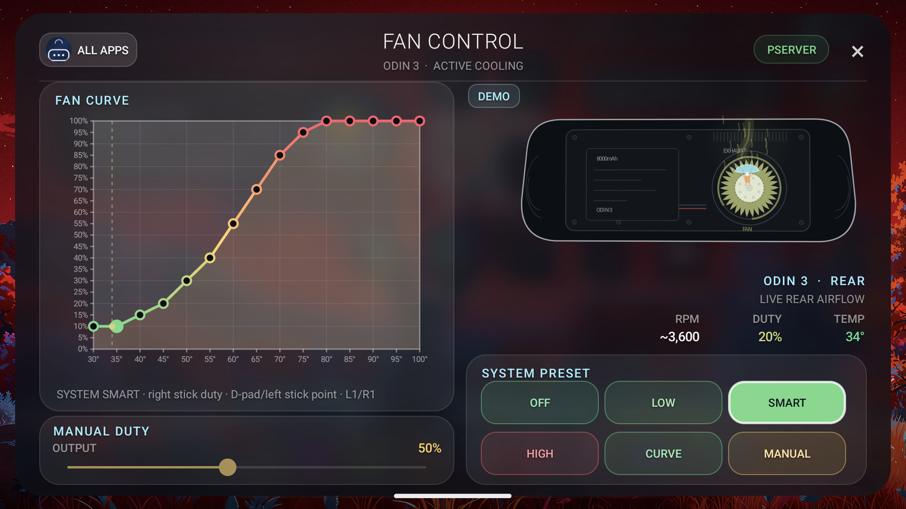
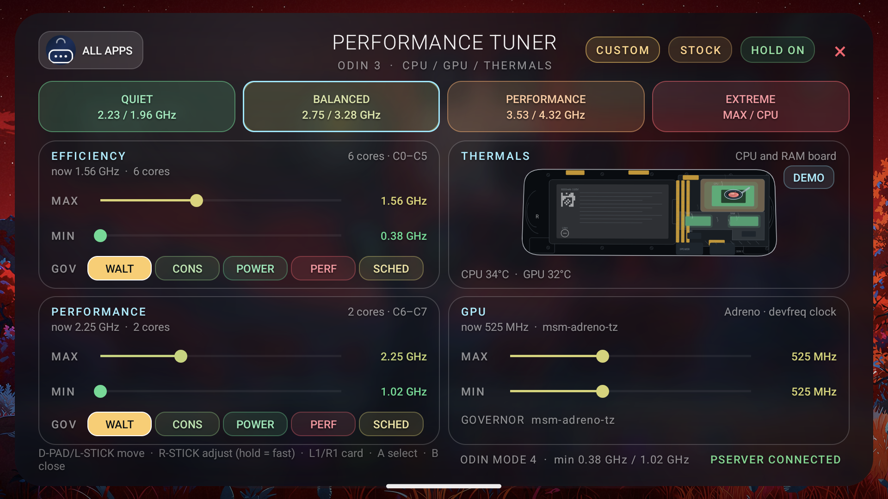
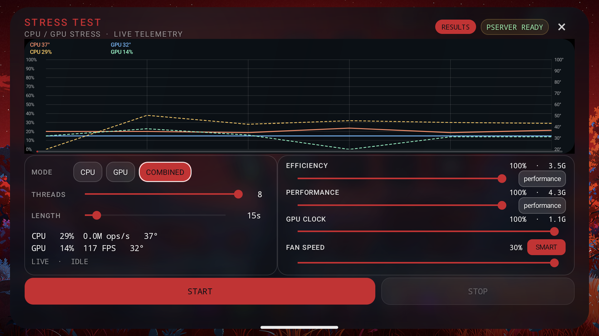
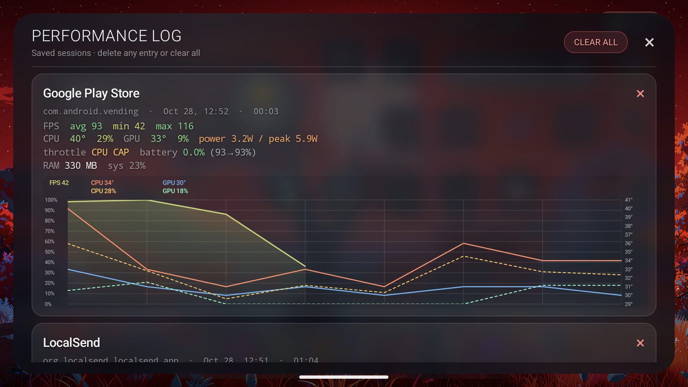

<h1 align="center">Pavo</h1>

<p align="center">
  <b>A landscape-first Android launcher for handhelds</b><br>
  Pure platform · no AndroidX · no Gradle
</p>

<p align="center">
  <a href="LICENSE"></a>
  
  
</p>

<p align="center">
  <a href="docs/home.png"></a>
  <a href="docs/fan-control.png"></a>
  <a href="docs/performance-tuner.png"></a>
</p>
<p align="center">
  <a href="docs/stress-test.png"></a>
  <a href="docs/performance-log.png"></a>
</p>
<p align="center"><sub>Home · Fan Control · Performance Tuner · Stress Test · Performance Log</sub></p>

**Download:** [latest release](https://github.com/Ben0019/pavo-launcher/releases/latest) ·
package `com.ben.pavo` · Android 12+

Pavo replaces the stock launcher with a console-style home: a large clock, a paged desktop,
a clear Liquid Glass dock and matching app drawers. It is built directly against the Android
platform (`Activity`, `View`, `Canvas`, `RenderEffect`) with `aapt2` → `javac` → `d8`.

## Features

- Landscape-first console home for Android handhelds; pure platform, no AndroidX or Gradle.
- Clock, date, weather and live status (CPU, network, battery, Bluetooth, sound).
- Paged icon grid with folders, drag and drop, resizable widgets and a grid-snapped clock.
- Liquid Glass dock with full and popup app drawers, built for controller-first navigation.
- Wallpaper card with live, video and recent wallpapers; IN USE marker and long-press remove.
- Wallpaper-derived accent across home, dock, drawer, built-in apps and the overlay.
- OLED protection: 1 px spiral pixel shift and a 10% idle dim, without freezing live data.
- Performance overlay with CPU/GPU/RAM/FPS, per-core telemetry, lock and direct controls.
- Tuning, display, fan, RGB, controller, touch, file and media apps built in.
- 25 languages; resolution, scaling and orientation aware.

## Build

| Requirement | Version |
| --- | --- |
| JDK | 21 (Eclipse Temurin) |
| Android SDK | platform 35, build-tools 35.0.0 |
| Android NDK | r27c (for the native remapper/touchmap helpers) |

The default toolchain lives under `$HOME/.local/opt`; no system packages are required.
Override with `ANDROID_SDK_ROOT`, `ANDROID_NDK_ROOT` and `JAVA_HOME`.

```bash
cd pavo
./build.sh          # -> Pavo.apk
```

`build.sh` runs `aapt2 compile/link` → `javac` → `d8` → `zipalign` → `apksigner`.

Release signing uses a local keystore that is **never committed**:

```bash
PAVO_KEYSTORE=/path/to/release.jks \
PAVO_KEYSTORE_PASS=... \
PAVO_KEY_PASS=... \
./build.sh
```

Without those variables it falls back to `keystore.jks` (created on first use).

## Install

Install `Pavo.apk` on the device (or run `adb install -r Pavo.apk`), then set it as the
home app:

1. Open **Settings**.
2. Go to **Apps**.
3. Open **Default apps**.
4. Tap **Home screen**.
5. Choose **Pavo**.

To return to the stock launcher, repeat the steps and choose the stock launcher.

## Testing

`tools/smoke.sh` launches the home screen and every built-in activity on a connected
device, fails on a crash or ANR, and validates the preference store (seeded, every
glass value inside its slider range).

```bash
tools/smoke.sh                              # installed build, single device
tools/smoke.sh --serial 192.168.1.2:5555    # pick a device
tools/smoke.sh --apk Pavo.apk               # install first, then test
```

Built-in activities are not exported, so the script uses `su` when the device is
rooted and reports a skip for them otherwise.

## Tested on

| | |
| --- | --- |
| Device | AYN Odin 3 |
| OS | Android 15 (SDK 35) |
| Build | `Odin3_V1.0.0.187_20260616_193307_user` |
| SoC | Snapdragon 8 Elite / Adreno 830 |
| Display | 1920×1080 landscape, 60/120 Hz, HDR10/HLG |
| Also tested | 1280×960 (4:3) and 1920×1080 (16:9) display modes |

## Licence

Pavo is released under the **Apache License 2.0** — see [LICENSE](LICENSE).

Part of the liquid-glass shader is adapted from
[Kyant0/backdrop](https://github.com/Kyant0/backdrop) (Apache-2.0); see [NOTICE](NOTICE) for
the attribution.

## Credits

- [Kyant0/backdrop](https://github.com/Kyant0/backdrop) for the AGSL liquid-glass lens.
- AYN for the Odin 3 hardware documentation used while tuning the panel.
