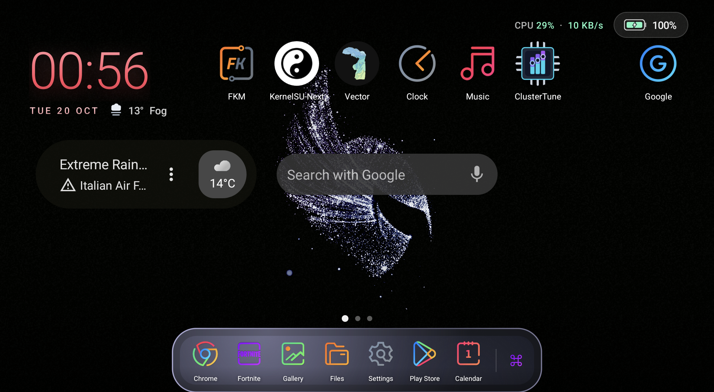
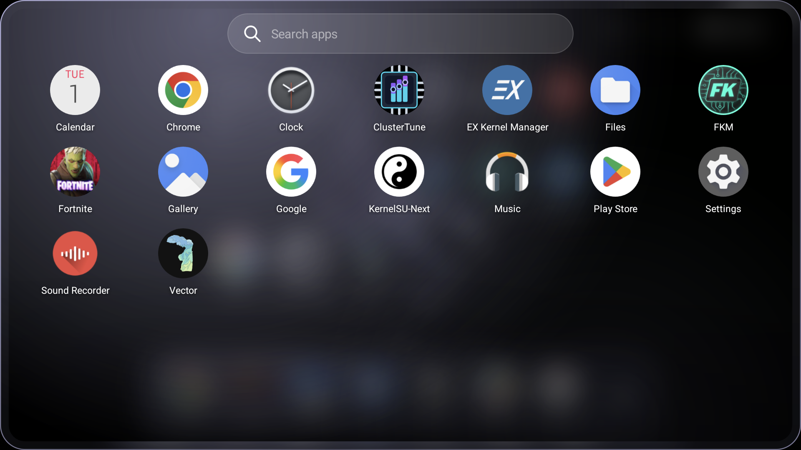
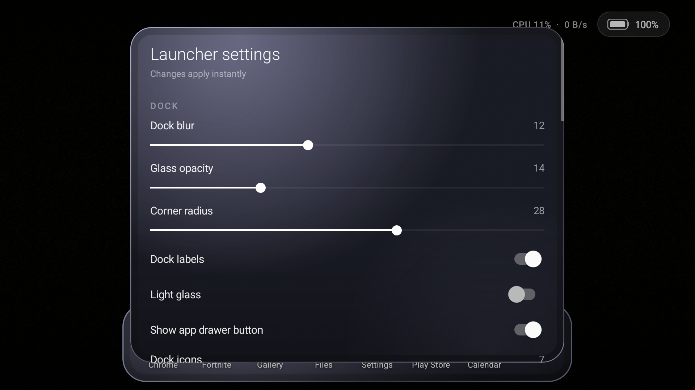

# Aurora

A landscape-first home screen for the **AYN Odin 3** (`NX789J`), built as a pure-platform
Android app (no AndroidX, no Gradle). It replaces the stock launcher with a console-style
home: a large clock, a paged desktop, a clear Liquid Glass dock and matching app drawers.

| Home | App drawer | Settings |
| --- | --- | --- |
|  |  |  |

## Features

### Desktop

- **Landscape console layout** — `sensorLandscape`; the desktop hides both system bars, while
  the built-in apps hide only the status bar and keep the gesture navigation pill visible so
  **swipe-up-to-home works reliably** from Display, Controller Remapper, Perf Logs and the tuner.
- **Clock + date + weather widget** — 24-hour by default (12-hour is a settings toggle). The
  weather sits **next to the date** with a crisp self-drawn icon (e.g. `MON 19 OCT  ☁ 16° Overcast`),
  with CPU load, network throughput, Bluetooth and notification-sound indicators next to the
  battery pill. **Tap the time/date to open the
  clock app; tap the weather to open Google's weather page.** The clock is a **true grid widget**: it snaps
  to home cells, spans as many columns/rows as its size needs (3×1 at the default scale on the
  icon-fitted grid), and moves exactly like an app — long-press, drag, and drop on a highlighted cell
  (or another page); apps underneath are relocated. Drop it on **Remove** to hide it. Its
  menu also has **Resize widget**; resizing reflows the grid live — the cell span is
  recalculated on every step, the widget's position is clamped inside the grid, and the apps
  move around the new footprint. **Reset position** returns it to the first cell. The clock is
  **red by default** (`#FF4D5E`) and the date uses a distinct pale coral (`#FFB3B8`); both are
  independently customisable — long-press the clock, choose **Change clock colour** or
  **Change date colour**, then pick from the RGB wheel, tune the brightness, or reset to the
  default. The time and date render with a **vertical colour gradient** derived from their
  selected colours, not a flat tint.
- **Density-aware icons** — on dense grids the launcher shrinks the icons to fit each cell and
  hides labels when even a compact icon plus a label will not fit, so rows never overlap.
- **Icon-fitted full-page grid** — the cell size follows the icon/folder size, and the grid
  tiles the **whole page**, so the wallpaper around your apps is still made of real cells.
  Every empty cell is a valid drop target: drag an icon into open space and it stays exactly
  there. Dropping in the **centre** of another app creates a folder, dropping on a folder adds
  to it, and dropping on an occupied cell swaps the two. Long labels ellipsize in the compact
  cells, and the clock spans only the cells its content needs. Reduce the icon size to fit more
  cells; increase it for larger icons and fewer, roomier cells.
- **Multiple home pages** — swipe horizontally between pages, with a page indicator above the
  dock that appears only when there are at least two pages. The indicator fades out shortly
  after you stop swiping; disable **Auto-hide page indicator** in settings to keep it visible.
  While dragging an icon, pause at the right edge and a fresh empty page appears; drop the icon
  there to keep it on its own page. Pages are also created automatically when the grid is full.
- **Performance overlay** — enable **Show performance overlay** in settings and grant
  **Display over other apps**. A liquid-glass panel shows CPU/GPU temperatures, clocks and
  load, **RAM usage / 16 GB total**, battery percentage, framerate with a rolling graph, and
  load + clock for every CPU core, all heat-coloured. Drag it anywhere; **pinch with two fingers to resize it**.
  **Double-tap the panel** to lock it to its current spot; a lock badge appears in the header
  and drag/pinch attempts give a haptic warning instead of moving it. Double-tap again to
  unlock. Each metric has its own visibility switch. It runs as a foreground service above normal apps;
  apps that deliberately hide non-system overlays (some system/secure apps) will cover it.
  Framerate sampling uses SurfaceFlinger through root and automatically picks the game's most
  active BLAST/SurfaceView layer, then caches it briefly and refreshes only the latency buffer;
  this keeps fast refresh modes light while reporting the real in-game rate. CPU load uses the
  aggregate `/proc/stat` delta and GPU load uses the KGSL busy/total counters, so rapid updates
  remain accurate rather than showing rounded instantaneous values. FPS shows — only when no
  foreground layer has frame timing.
- **Overlay control menu** — **long-press anywhere on the performance panel** to open a
  liquid-glass control card without lifting the finger. **Drag the ⠿ grip or the title to move
  the card anywhere on screen.** The live overlay stays visible (and ignores touches) while
  the card is open. Turn the overlay off, toggle any individual
  metric, set the **refresh interval from 500 ms (0.5 s) to 10,000 ms**, adjust transparency and size, reset its position, map the **app drawer shortcut**,
  or switch the device performance mode between **Normal / Standard / High** (the same state
  as the Odin Quick Settings performance tile; root is used to apply it). Pinch resizing uses a damped, eased response so it is not
  twitchy. The FPS graph keeps a 60-second time window, so faster refresh modes add more graph
  points and slower modes show fewer; saved sessions keep roughly two minutes of history.
- **Detailed performance monitor** — open it from Launcher settings → Performance. The home-screen long-press menu now simply **shows or closes the performance overlay**. It is a
  large liquid-glass overlay for the app the sampler is currently reading, colour-coded by
  load/heat/FPS/battery. It shows **live FPS and a frame graph**, **average / minimum / maximum
  FPS**, **CPU and GPU temperatures, loads and clocks**, **battery power draw and peak**,
  **thermal / CPU / GPU throttle state**, **session runtime**, **battery used (% and mAh)**,
  **per-app RSS**, and **system RAM**. The monitor is non-focusable, so the target game/app
  stays in front and keeps producing frames while you read it.
  The performance log uses the same glass transparency as Controller Remmaper; D-pad/left stick scrolls session cards with haptics, hold accelerates, and A opens a detail that also scrolls with the controller.
- **Perf Logs app** — a built-in launcher app in the app drawer. It can be dragged to the
  home screen or dock like any other app, supports multiple copies, rename / change icon and
  remove, and has no uninstall action. While **Log performance
  sessions** is enabled in Launcher settings and the performance overlay is running, each
  foreground app session is saved with its app/package, timestamp, duration, average/min/max
  FPS, recorded FPS history, maximum CPU/GPU temperatures, average loads, average and peak
  power, worst throttle state, battery used (%/mAh), app RSS and system-memory peak. Open
  **Perf Logs** from the drawer to view the colour-coded sessions. The saved session cards are
  loaded **before the first frame**; a short delayed refresh only catches a session that was
  flushed as the app opened, so the list is never briefly empty. **Tap any session card** and
  it expands with an animation into a full detail card with the larger FPS graph and the full
  metric breakdown. The list card stays behind the detail under a dimmed glass focus veil and
  a soft blur, and the detail shrinks back into its session card when closed. **Long-press the
  empty card area at the top** (or hold A) for global options: auto-clean every app's saved
  sessions older than **1 / 3 / 6 / 12 / 24 hours** (or Off) and adjust one shared glass
  transparency slider that updates both the log list and detail cards. Controller navigation in
  the popup moves **left/right** between retention choices, **up/down** through the retention
  row, transparency slider, shortcut mapping and Done, scrubs the slider with left/right or the
  left stick (hold to accelerate), selects with **A** and closes with **B**. The **Map long press** row captures a
  controller button; holding it while Perf Logs is open opens this popup. Use the row **×** to delete one, the detail card's **DELETE THIS SESSION**
  button, or **CLEAR ALL** to erase the history. Up to 200 sessions are retained.
- **Display** — a built-in launcher app in the app drawer, also linked from Launcher settings → Display.
  It merges the system display controls with Aurora's display options: current panel size, density,
  refresh rate and HDR state; **Auto / 60 Hz / 120 Hz** refresh; native, 1600 × 900 and 1280 × 720
  resolution presets; display-size/DPI presets; Aurora colour saturation/glow; burn-in protection;
  and a stock display reset. Changes use PServer first, with a root-shell fallback. Resolution and
  density changes affect the whole device; **Reset display** returns to native size/density, auto
  refresh and auto rotation. The
  launcher's old Colors section and burn-in switch have been removed from Launcher settings so
  those controls live only here.
- **Display calibration** — the Display app's **CALIBRATION** card controls the real panel output:
  global saturation `0–100 %`, white point `2500–6500 K`, HDR10/HLG user override, independent
  **red / green / blue** gain `50–150 %`, and **Reset calibration** (100 %, 6500 K, neutral RGB,
  HDR on). Saturation, temperature and RGB are composed into one display-wide SurfaceFlinger
  colour matrix, so they apply to every app and game rather than a launcher overlay. Saturation is
  folded into that matrix instead of using ColorDisplayService's asynchronous transform, avoiding
  a visible ordering race. HDR uses the framework's per-display user-disabled HDR list. The
  settings persist in Aurora preferences and are reapplied when the launcher starts and whenever
  Display opens. Night Light and DWB use the same SurfaceFlinger matrix, so calibration takes
  precedence while active; **Reset calibration** clears the matrix. The controls require
  PServer/root; without it the card is disabled.
- **RGB Lighting** — a built-in launcher app in the app drawer, draggable like the other
  built-ins. It controls the two SN3112 joystick LED drivers exposed by the Odin 3 at
  `/sys/class/sn3112l/led` and `/sys/class/sn3112r/led`. The **colour wheel** selects hue and
  saturation, with hue/saturation sliders for controller-only use. The **Output** card combines
  brightness with an animation-speed slider from 10% to 300% (100% is normal) for breathing,
  rainbow, strobe and screen colour blending. Colour, Output and Mode are three equal-width
  cards side by side; a **Hue & Saturation** card sits below Output and Mode. The whole screen
  uses one unscrollable grid, and the joystick outlines have their own centred card above it.
  Two **live joystick outlines** show
  the real stick positions from the controller
  axes; each outline has an RGB ring that mirrors the colour being written. **Tap either
  outline** to toggle that stick's ring. Modes are **Static / Breathing / Rainbow / Strobe /
  Screen / Off**. Every write targets both the main light (`1-r:g:b`) and the handle ring
  (`2-r:g:b`), so the full ring around each stick is covered. PServer is the preferred
  transport (the status pill shows `PSERVER`), with a direct-file fallback; the nodes are
  world-writable but SELinux normally requires the rooted path. Static updates are sent while
  the wheel is dragged, not only on release. Animated modes run in a foreground `RgbService`
  so they keep going after the app is closed, with a low-importance notification whose
  **STOP** action turns the LEDs off. **Screen** mode captures the display through PServer's
  raw screencap path, picks the dominant saturated colour and blends the LEDs toward it; it
  samples while this app is closed, so leave the app to see the screen-follow effect. Colour,
  brightness, targets and mode persist in Aurora preferences. Changes apply live; a
  three-pulse giggle haptic lands on the built-in card when it opens, and the wheel gives
  scrubbing ticks. The colour wheel is the initial controller focus and draws a circular
  navigation ring; while it is focused, the right stick moves the wheel dot in the same 2D
  direction as the stick, latching the chosen colour when released instead of returning to the
  wheel centre. When a slider has focus, the right stick slides it quickly and smoothly in the
  stick's horizontal direction; both the wheel and sliders emit throttled haptic ticks as they
  change, and slider thumbs are compact and inset so they never touch the card border. D-pad or
  left stick moves focus
  between the wheel, joystick outlines, effects, Output and Hue & Saturation sliders; A toggles
  a focused joystick outline or selects a focused control; B/Back closes. All section cards
  share one fill, border, radius, padding and title/hint scale, and Output/Mode share the same
  dimensions.
  Opening from a home or dock icon uses the normal card-to-icon return animation; from the
  drawer the card closes normally.
- **Fan Control** — a built-in launcher app in the app drawer, draggable like the other built-ins.
  It exposes the Odin 3 fan's system presets **OFF / LOW / SMART / HIGH**, a **MANUAL** duty
  control (10–100%), and an editable **CURVE** graph from 30–100 °C with draggable points and a
  100 °C end stop. Dragging a point automatically activates CURVE. The curve is applied by a
  foreground `FanCurveService` using the CPU/GPU peak temperature, so it
  keeps running after the app is closed; its notification can switch back to SMART. The live
  rear-chassis outline is tucked into the card's top-right corner, with the right-aligned
  ODIN 3 · REAR label, live airflow label, RPM, duty and temperature directly beneath it. The
  curve editor occupies the large upper-left card, with manual duty beneath it; system presets
  remain on the right. The graph shows the curve for the active preset (OFF/LOW/SMART/HIGH,
  MANUAL duty, or the saved custom curve); dragging any preset point switches to a manual
  custom CURVE. The curve has a draggable control point every 5 °C; temperature and duty axes
  are labelled in 5-unit steps (30–100 °C and 0–100%), and dragged points snap to those
  5-unit increments. Curve segments, preset chips, duty readouts, the fan blades and exhaust
  airflow are colour-coded on a green → amber → red ramp driven by measured speed, duty and
  heat. The rear model uses a smaller fine-blade blower rotor, with animated exhaust rising out
  through the top vent above it. Rotor phase is driven by measured RPM (displayed at a 20×
  slow-motion factor so the blades stay legible), with immediate spin-up and an inertial
  coast-down when the fan is switched off; exhaust density follows the same speed.
  The header carries the same app-context picker as the Performance Tuner: **ALL APPS** uses
  the global fan profile, while selecting any launchable app edits a fan-only per-app override
  (mode, manual duty and custom curve). **USE GLOBAL** removes that app's override.
  `PerAppFanService` watches the foreground app and applies its fan profile, falling back to the
  global profile for apps without an override; the Fan Control screen pauses the watcher while
  open. Fan writes use PServer/root through the tuner's existing root path. Controller
  navigation covers the preset chips and manual slider; the graph is edited by touch. The app
  follows the same liquid-glass card, transparency and haptic conventions as Perf Logs.
- **Touch Mapper** — a built-in launcher app for Android games that only expose on-screen touch
  controls. Pick a target game, then drag the **A / B / X / Y** buttons and the **D-pad** onto
  the game's own controls on the 16:9 layout preview; every placement is stored per game. The
  movement control can switch from the D-pad to a **virtual analog stick** placed anywhere on
  the left side: the Odin's left stick drives that touch pointer with a dead zone, while the
  face buttons stay independent. Enabling the mapper starts a foreground service that waits for
  the selected game, draws a non-touchable button guide over it, and launches a native
  PServer-root helper (`assets/aurora-touchmap`, `native/aurora-touchmap.c`). The helper creates
  an `Aurora Virtual Touch` multitouch device and converts the controller's raw buttons and
  left-stick axes into simultaneous touch pointers, so movement, holds and face-button presses
  overlap correctly. The **RIGHT STICK** selector is stored per game and cycles through
  **OFF / AIM / SWIPE / MOUSE / JOY / MOBA**. **AIM** is a 360° swipe control for
  twin-stick games such as Bullet Echo: left/right on the right stick drags a hidden horizontal
  aim finger across a clear right-side band, the game rotates the hero, and releasing leaves
  the last facing in place instead of snapping back. It deliberately draws no right-stick base
  over the game. **SWIPE** turns  the right stick into a virtual finger inside a draggable swipe zone, **JOY** adds a normal
  right-side analog movement stick, and **MOBA** gives that movement stick a right-hand MOBA
  placement. **MOUSE** creates a real
  `Aurora Virtual Mouse` device: the right stick moves the system pointer, **R1** left-clicks
  and **R2** right-clicks while face buttons keep their touch mappings. The swipe and movement
  zones can be dragged in the layout editor just like the buttons. The normal controller
  remapper is paused while the mapper is active,
  because both helpers need the physical controller, and is restored when the game leaves the
  foreground. The helper is tied to Aurora's process and exits if the app is force-stopped, so
  it cannot leave the controller grabbed. Profiles live separately from fan and tuner overrides;
  the mapper is disabled by default and the layout editor assumes a 16:9 landscape game.
  While the selected game is in front, a small translucent **crosshair handle** floats at the
  top centre. One tap opens the **Touch Map** card; tapping the handle again closes it. The card
  can switch the right-stick mode, save the current game profile, add controller buttons from
  the palette — A/B/X/Y, D-pad, L1/R1, L2/R2, L3/R3, Select, Start, C/Z, Mode, Home, Back,
  Apps and Volume ± — remove buttons, and shows the current button set. **EDIT LAYOUT** hides the card
  and leaves a full-screen **DONE** toggle so every enabled button and both sticks can be dragged
  anywhere on the game surface without the card covering them. Changes auto-save for that game;
  closing the editor restarts the mapper with the new layout. The palette's **R3 STICK** entry
  adds a second right-stick guide; both guides stay visible, the normal guide is always active,
  a simple R3 tap presses the R3 guide's centre, holding R3 and moving the right stick drives
  that second guide, and releasing R3 returns the right stick to the normal guide. Profiles are valid with no face
  buttons at all, as long as the left virtual stick or right-stick mode is enabled.
- **Performance Tuner** — a built-in launcher app (also in Launcher settings → Performance).
  Four profiles (**Quiet / Balanced / Performance / Extreme**) set the Odin performance mode,
  CPU cluster ceilings, GPU ceiling and governor together. Manual controls cover the
  efficiency (C0–C5) and performance (C6–C7) CPU clusters, GPU min/max clocks and CPU governors.
  Fan control has been removed from this app and lives exclusively in Fan Control. Its former
  fan card is now a **THERMALS** card with the CPU/RAM mainboard outline, live CPU/GPU
  temperatures, heat-coloured chip dies and rising steam. The Tuner, Fan Control and overlay
  all use one shared HAL-aligned thermal reader that takes one sensor per CPU core and the GPU
  sensor bank, instead of the duplicated hotspot zones that previously inflated readings. The tuner uses the same glass
  transparency setting as the remapper and Perf Logs. Profiles, sliders and mode chips share a
  green → amber → red intensity ramp, with low settings green and the hottest settings red.
  The title is centred at the top; the app-context button sits to its left and shows **ALL
  APPS** or the selected app's icon. Tapping it opens a thin, transparent vertical app strip.
  Pick any app to edit its CPU/GPU tuner configuration; every slider, profile, governor and
  stock reset then applies to that app. Apps without a saved override use the global tuner
  configuration. Tapping the app button again reopens the strip, and **USE GLOBAL** removes the
  current app's override. A background watcher applies the full saved configuration when its
  app comes forward and restores the global configuration for apps without overrides.
  **HOLD** runs a small foreground service that keeps the chosen clock caps applied while the
  vendor tries to restore its own values; it backs off above 72 °C so cooling still wins.
  **STOCK** restores the device defaults. On AYN/Retroid firmware it uses the built-in
  privileged **PServerBinder** service first, so no Magisk/KernelSU root is needed; a root
  shell is only a fallback when PServer is unavailable. Changes reset on reboot.
- **Built-in app glass** — Display, RGB Lighting, Performance Tuner, Perf Logs and Controller
  Remapper use a
  clear outer Liquid Glass sheet over the live compositor blur, so the real wallpaper and icons
  remain visible while their inner content cards stay tinted for readable labels and sliders.
  The dock, full drawer, popup drawer and floating side drawer use the **same clear recipe**
  (`0x4D` tint, top/bottom shading, white specular, frost noise and a 14 dp refracting rim) on
  their own live screen sample, so their card backgrounds match the built-in apps.
  They draw edge-to-edge but leave the transparent gesture navigation bar in place, which keeps
  the system **swipe-up-to-home** gesture working instead of requiring an immersive-mode swipe.
  Each built-in app also runs in its **own task** (`taskAffinity` + `FLAG_ACTIVITY_NEW_TASK`),
  so the go-home transition shrinks/fades only that app instead of moving the home task to the
  back and then forward again (which flashed bare wallpaper and then the app before returning).
  Closing returns to a sharp home; Display also hides the performance overlay while open.
- **Page transitions** — choose **Slide**, **Fade**, **Zoom**, **Cube**, **Stack**, **Parallax**
  or **Random** in settings. The transforms are deliberately exaggerated so they are clearly
  visible. Random picks a fresh animated transition for every page change (plain Slide is
  excluded), while an individual choice stays fixed.
- **Folders** — drop one app in the **centre** of another to create a folder, or drop it on the
  **edge** of another icon to swap places; dropping onto an existing folder adds the app. The folder tile is a mostly
  **transparent glass tile** that lets the live wallpaper show through;
  its 2×2 preview keeps the child icons' **original colours**. Tapping it opens a
  compact card that uses the **same transparent live-glass background** as the tile and
  **sizes itself to the number of apps** (2×2 for small folders, growing to 3, 4 or 6 columns).
  Opening a folder **grows the card out of the tile with a springy zoom**, and closing it
  **shrinks back into the tile** with the scrim fading.
  Long-press a folder for
  **Open / Rename / Unpack folder / Remove**; long-press an app inside for
  **Open / App info / Remove from folder**. Apps can be dragged from the drawer straight into
  a folder, and **dragged out of a folder onto the home or into the dock** (the folder fades
  while you drag; dropping on **Remove** detaches the app from the folder).
- **Drag & drop** — long-press an icon to lift it; the item menu appears immediately while your
  finger is still down, and dragging dismisses it. Drag to:
  - drop it on any empty cell — every part of the page is a cell, even the open wallpaper,
  - move it between pages or into the dock, or pull it out of the dock,
  - while a drag is in progress, every page becomes a rounded card. The card surface uses
    almost the full page, so outer icons, labels and widgets sit inside it instead of poking
    through the border, and the card exposes the actual grid cells. Free cells are drawn with
    a brighter translucent fill so every available drop position is visible. Moving into the narrow margin outside the card and holding briefly
    switches fully to the adjacent page card with an eased slide; the outgoing and incoming
    cards dip and fade slightly for depth. The icon can then be placed anywhere on that page.
    The edge switch latches until you move back in, so holding there cannot flip through pages.
    Releasing before the edge dwell finishes places the icon on the edge cell of the current
    page; releasing during the slide waits for the target page to settle and drops there.
    Releasing outside a valid cell or widget target springs the icon back instead of mutating
    the layout. The carried icon sits above the pager, so the card slide never clips it,
  - hover over an occupied cell to make room: the target icon slides toward its next slot
    with a spring, leaving the drop cell open. A real AppWidget under the finger moves to a
    free widget slot instead of blocking the drop,
  - drop it in the centre of another distinct app to make a folder, or onto a folder to add
    it. A single app can never become or make a folder; folders always contain at least two
    apps, and a folder left with one app automatically unpacks back onto the grid,
  - drop it on the **Remove** target at the top to delete it.
  The source cell goes completely empty as soon as the drag begins, with no faded icon,
  label or focus plate left behind; the icon under your finger is the only copy. It follows
  your finger **directly, with no catch-up delay** (the same immediate tracking as the
  performance overlay), the target slot is highlighted, and the ripple is the drop
  animation: there is no landing flight before it. Icons displaced by a replace/insert
  glide from their previous positions into the refreshed layout. Long-pressing an app sends
  an invisible radial wave through the surrounding icons and dock apps; a drop sends a
  larger, shorter and exaggerated version of the same wave. Widgets stay still, no visible
  ring or separate water-drop lead-in is drawn. Home, dock and widget drags all use this
  tracking. Returning an icon or folder to its original spot restores it immediately on
  release and emits the same ripple; the page is not rebuilt, so there is no flash or snap
  when the dragged icon lands back home. Dropping an icon back on its own original cell
  is always a no-op, even while the page is card-scaled under the finger.
- **Long-press an app** (home, dock or drawer) — the menu appears **while you hold**, with
  **App info**, **Uninstall**, **Rename**, **Change icon**, **Pin to / Add another to dock**,
  **Add another to / Remove from home**. The same app can appear **multiple times** on the
  home and in the dock; each copy is an independent slot, so removing one leaves the others
  alone. Renames and custom icons are global, so they apply to every copy, the drawer and
  folders.
- **Real AppWidgets** — long-press empty space → **Widgets** to browse installed widget
  providers. The picker is a compact glass card using the launcher-settings transparency,
  with a ringed title and a drag grip for moving it. Pick a provider, approve Android's
  widget access prompt, and Aurora binds it through
  `AppWidgetHost`. Widgets are placed into free grid cells (a new page is created when the
  current page has no room), keep their provider's live updates, and survive restarts.
  **Long-press a widget to open its edit menu, then drag it to move it exactly like the clock
  widget** — the target cell is highlighted, grid bounds are respected, other widgets and the
  clock cannot be overlapped, apps underneath are relocated, and dropping on **Remove** deletes
  it. **Resize widget** and **Remove widget** are in the same long-press menu; there is no
  permanent handle on the widget.
- **Icon packs** — long-press empty space → **Icon packs** to scan installed packs that contain
  an `appfilter.xml` or `drawable.xml`. Icon-pack files are parsed once, **cached and prewarmed**
  in the background, so reopening the picker or the per-app icon card is immediate. Choosing a
  pack remaps app icons globally on the home, dock, drawer, folders and shortcut pickers;
  per-app custom icons still take precedence. **System default** restores the stock icons.
  Packs can be switched without restarting.
  **Change icon** on any app now opens an icon card listing every installed pack; selecting a
  pack shows **all of its icons in a scrollable grid**, and tapping one applies it to that app.
  With a controller, D-pad / HAT / left stick moves the focus ring by icon, up reaches the pack
  chips, down from the last row reaches Reset / Choose image / Close, A selects and B closes.
  The grid no longer steals the first D-pad event or draws its ring before scrolling settles.
  The card also keeps **Choose image…** and a **Reset** button that removes the custom icon.
  Both icon cards use a clear **Liquid Glass** sheet over a screen-positioned blurred snapshot of
  the home. The snapshot fills the screen behind a dim layer, so wallpaper, icons and widgets stay
  in the right place; the card adds a refracting rim, a specular top edge, a subtle chromatic
  fringe and localized header/footer dimming. The performance overlay is hidden while either card
  is open. D-pad/stick moves a focus ring through the grid, **A** applies the focused icon, **B**
  closes, and the pack chips plus **Reset / Choose image / Close** are reachable from the grid.
- **Long-press the clock/date widget** — Launcher settings, **Change clock colour**,
  **Change date colour**, **Resize widget**, or **Remove clock & date** (it can be restored with
  the **Show clock & date** switch).
- **Long-press empty space** — **Launcher settings**, **Add app shortcut**,
  **Add web shortcut**, **Widgets**, **Icon packs**. The menu opens **beside the point you
  pressed**, flipping above/left when it would run off-screen.
  The long-press only fires after holding still for 0.56 s; any swipe cancels it.
- **Web shortcuts** — name + URL; they open in the default browser.
- **Live battery pill** — the battery fill changes from green to amber to red as the level drops,
  and a lightning bolt appears while charging. **Tap the pill to open Android's battery screen.**
  The optional CPU/network readout sits next to it, with CPU and network values coloured on the
  same green → amber → red load ramp. A **Bluetooth glyph** has three states: **off** is red with
  a slanted mute bar, **on but not connected** is blue with the normal glyph, and **connected** is
  green with Android's paired side-dot icon. A **bell glyph** is blue when notification sounds are
  audible, amber with vibration ticks when the ringer is on vibrate, and red with a mute slash when
  silent or in Do Not Disturb. Both indicators can be hidden from
  **Launcher settings → Clock, weather & status**.

### Dock

- **Transparent Apple-style liquid-glass dock** — pinned apps, a divider and the app-drawer
  button (which can be hidden). The dock uses the **same clear Liquid Glass recipe as the
  built-in apps**: a fully visible blurred screen sample, the built-in `0x4D` dark tint,
  localized top/bottom shading, drifting white specular highlights, fine frost noise and an
  **Apple-like refracting rim** that magnifies the backdrop near the edges. The blurred sample
  is re-taken on page changes/resume and when you move the **Dock blur** slider. The same clear
  card material is used by the full drawer, popup drawer and built-in app cards.
- **Dock blur** controls the sample's blur and **Glass tint** controls the clear-glass tint
  in real time; **Dock size** is
  adjustable from **80% to 130%** and starts at the smallest **80%** (height, icon size, labels,
  spacing and drawer button all scale, and the home grid reflows around it).
- **Dock position** — **Left**, **Center**, **Right** or **Hidden**. Left/right turns the
  dock into a **vertical strip on that screen edge**; Center keeps the horizontal bar at the
  bottom. **Hidden** removes the dock entirely; swipe-up still opens the full app drawer.
  When the dock is vertical, dragging an icon shows **bottom-left / bottom-right arrow
  hotspots** for the previous/next page, inset so they clear the side dock.
- **Dock icon count** is adjustable from 3 to 8 in settings.
- The dock's app-drawer button scales to the **same icon size as the pinned apps** and now
  carries a **name label — `Apps` by default** — below the icon. It uses the selected icon
  pack's dedicated drawer icon (`app_drawer`, `drawer`, `apps`, etc.) when available. It sits
  directly among the dock pins with **no divider**. **Long-press and drag it to any slot**; a
  glowing insertion bar previews the slot. The dock menu opens while you hold it; keep moving
  to drag, or release to leave the menu open. The menu includes **Open app drawer**, **Rename
  drawer button**, **Change icon**, **Choose image…**, **Reset icon** and **Launcher
  settings**. The name follows the **Dock labels** visibility setting.
- Adjustable corner radius, light-glass mode and dock labels.
- **Dock drag & drop** — reorder pins inside the dock; a glowing insertion bar shows the drop
  point. Dragging a home icon into a full dock moves the replaced pin back to the home. The
  **empty horizontal strips to the left and right of a bottom dock are also dock drop
  targets** — drop there to insert at the beginning or end. App icons follow your finger
  directly, with a smoothed landing tween when dropped.
- **App open / close / swipe home** — built-in apps expand their **actual glass card** from
  the tapped home/dock icon and shrink it back into that icon on **Back** and **swipe-home**.
  The window blur stays with the shrinking card for a clean close, and the home icon is the
  final target. External apps use the system's own window open/close animation; the launcher no
  longer covers it with a full-screen icon sheet. The launched icon no longer stays faded,
  shrunken or ringed because drawable bounds are preserved after building the launch snapshot.
  Popup drawers, long-press menus and the settings side menu still use the Magic Lamp mesh.
  Returning home settles the desktop back in without dimming or a flash.

### Controller sliders

Across Launcher settings and the built-in apps, the D-pad or left stick moves focus between
controls. Sliders are adjusted only with the **right stick**; horizontal deflection now
accelerates the step rate, with a repeating haptic tick. Right-stick vertical deflection
accelerates scrolling in the home app drawer, floating side drawer, Launcher settings, Display,
Perf Logs and the other scrollable built-in surfaces. Touch control is unchanged.

### App drawer

- A large **inset clear-glass card** matching the built-in Performance Logs/Display card, with a
  7-column grid (adjustable 4–9) over a blurred snapshot of the current home, a small centred
  search field and no title/close chrome. The dim scrim is cut out behind the card, so the card
  alone carries the Liquid Glass.
- **Swipe up and down follow your finger** — the drawer tracks the pointer in both directions,
  with the card scaling slightly as it moves. A fast flick opens from a short pull; a slow
  release settles open past about a third of the travel. Dragging down starts only when the app
  grid is at its top (or from the header), so normal grid scrolling still works. Settle
  duration is derived from release velocity, and the card gives a springy pop when it reopens.
  **Swipe down inside the drawer to close it.**
- **Drag apps out of the drawer** — long-press an app, then drag it onto a home cell or the
  dock. The drawer fades out during the drag, the target slot highlights, and the icon settles
  into place. The app stays in the drawer.
- **Popup drawer** — enable **Dock button opens popup drawer** to make the dock button open the
  compact window; it opens on the same side as the dock (left, center or right), inset beside
  a vertical side dock, and follows the **drawer button's current dock slot** so it opens next
  to where you placed it. Opening and closing play a quick, smooth **macOS-style Magic Lamp /
  genie mesh warp** (about 0.50 s in, 0.38 s out): the card unfolds from the dock button, and
  on close its lower edge necks back into that button with a curved funnel and a soft lamp
  flare. The **swipe-up gesture always opens the full drawer**, regardless of this option.
  Tapping the card itself only dismisses the search keyboard; **tap the dimmed area around the
  popup to close it.**
- **Floating drawer above any app** — map a controller button in **Launcher settings → App
  drawer shortcut** (or in the performance overlay's control card). A **single press** slides a
  narrow clear-glass strip in from the **left edge** over the current game/app. The service
  takes a fast raw display sample before showing the window and blurs it **inside the card
  only**, so the rest of the game or app stays sharp; no full-screen window blur is used. It is
  a single vertical column of apps sized to the selected icon size; labels follow the normal drawer
  label setting and stay fully opaque. Aurora's built-in launcher apps — Performance Tuner,
  Perf Logs, Display, Controller Remapper, RGB Lighting, Fan Control and Touch Mapper — appear
  alongside installed apps and open as transparent cards over the current foreground app; Back
  returns to that app. The only top control is a search icon; tapping it
  briefly widens the strip into a search field. **Long-press that icon for the compact, transparent drawer-style popup** beside the
  strip: transparency and icon size. The popup can be dragged by its title, and opening it,
  its +/− controls, tapping the screen to close it, and closing it with the mapped button all
  give haptic feedback. Its
  transparency applies only to the sidebar glass, never its icons. **Up to four apps can be pinned as
  favourites** by dragging an app onto the small star slot at the top; the drop area
  highlights while you hover.
  The mapped button mirrors the performance overlay: a **short press** opens or closes the
  drawer, or closes just the style popup when it is open; **holding the button opens DRAWER
  STYLE while your finger is still down**, with a long-press haptic. Tap anywhere outside the strip or press the mapped
  button again to slide it away. While the search field is focused, Back
  first dismisses the keyboard. Tapping an app launches it and dismisses the drawer. The
  floating button is observed by the PServer-backed controller service, so it still reaches
  the foreground game without requiring accessibility. When the accessibility service is
  bound, the drawer uses its trusted overlay layer; otherwise it falls back to a normal
  display-over-other-apps overlay.
- **Clear liquid glass** (settings toggle, on by default): uses the built-in app's white
  specular highlights, rim light, top/bottom shading and dark clear-glass tint on the drawer
  card. Turn it off for the darker frosted variant; icons and labels stay opaque either way.
- **Springy / giggle cards** — the popup drawer, full app drawer, built-in app cards,
  icon-pack dialogs (including the per-app icon chooser), the Launcher Settings card and
  its side menu, and every long-press menu (icon, empty space, clock, widget, folder or dock
  button) finish opening with a short overshoot and a damped side-to-side **giggle**. The
  giggle drives a synchronized three-pulse decaying haptic waveform, scaled by the launcher's
  haptics strength setting.
- Optional icon labels; per-app icon and label customisation shared with the desktop.
- Drawer icons open with a Pixel-style zoom-back animation on the home.

### Controller

- **D-pad or left stick** — move the focus ring across the home grid, dock, popup/full app
  drawer, opened folders and the rows of every long-press popup menu. The left stick uses a deliberate dead zone and axis lock, so a
  small thumb movement or diagonal wobble does not move focus; it takes a confident push and
  then repeats slowly while held. Android's low-threshold synthetic D-pad fallback from the
  stick is ignored in favour of Aurora's own threshold. The focus plate is **dark translucent
  with a randomly coloured bright rim**. It is drawn as an overlay sized to the actual icon
  bitmap (plus a small margin), so it adapts when icon sizes change and can never be clipped by
  the taller grid cell, header or page edges. The **Apps** dock button is ringed on its icon
  only; its name stays outside the selection.
- **A** — open the focused app, folder, shortcut or the **Apps** dock button, or activate the
  highlighted popup-menu row. This includes the home/clock/item/dock long-press menus, the
  Launcher settings section list and its submenus, the performance-overlay control card (D-pad and left stick),
  the floating drawer style card, and the widget/icon-pack/colour/size pickers. The first press
  after returning home selects the first item instead of launching something by accident.
  Popup rows use an accent focus ring and move with the same stick/D-pad dead zone and repeat
  behaviour; **left/right adjusts a focused slider** and **A toggles a focused switch**.
  Holding left/right accelerates sliders in Launcher settings, the tuner, Display and Perf Logs.
- **B** — close the app drawer, folder, popup, settings submenu or settings card, with haptic
  feedback. On the bare home screen it does nothing, so the controller cannot accidentally
  leave Aurora.
- **R1 / L1** — next / previous home page, including the same page-transition animation used
  by swiping. Focus returns to the first item on the new page (or the dock when the page is
  empty).
- **ZL (L2) / ZR (R2)** — open the compact popup drawer / full app drawer. Press the same
  button again to close it; pressing the other button switches between the two. These only
  act while the launcher is in front.
- **Floating drawer** — opening it immediately selects its first item. The D-pad (both HAT-axis
  and `BTN_DPAD` event forms) or left stick moves the selection through favourites and the full
  app list using the same deliberate dead zone, axis lock and slow repeat as the home screen.
  The list smooth-scrolls just enough to reveal the next row. **A** launches the selected app
  and **B** closes the drawer. This is handled by the PServer-backed controller service's
  raw evdev bridge, so it works even when Aurora is not the foreground window. While the
  drawer is open, the native remapper swallows controller input so the game behind it does
  not also react.
- Closing the drawer/folder returns focus to the dock button or icon that opened it.
- These launcher controls are independent of the global **BTN_Z** performance-overlay and
  **BTN_C** floating-drawer shortcuts; A/B/R1/L1 are only consumed while Aurora is in front.

### Controller remapping

- **Controller Remmaper** is a built-in launcher app (also **Launcher settings → Controller
  remapping**). It edits a system-wide profile, not just Aurora's own controller shortcuts.
- **Two modes:** the default **PServer root daemon** mode launches a small evdev/uinput daemon
  (`assets/aurora-remap`, `native/aurora-remap.c`) through **PServerBinder**, with `su` only as a
  fallback. It grabs the controller and exposes one fully remapped virtual controller, including
  analogue axes, and reports raw buttons over an abstract local socket for shortcuts and the
  floating drawer. The optional **No-root accessibility** mode consumes key events through the
  accessibility service and injects them through an app-created virtual controller instead.
- **Any button → any button** remapping, including useful A↔B swaps, plus per-button
  **TURBO** (auto-repeat while held). Select a row and press the target, press **Y** to toggle
  turbo, or press the same button again to clear it.
- **Combinations** map two to four simultaneous buttons to a shortcut pulse, for example
  **L1 + R1 → Z**. Add one with **+ ADD**, press the chord, then press the target.
- The editor shows a large **Odin 3 face outline** above the list, following the real hardware:
  left stick above the D-pad, the X/Y/B/A diamond above the right stick, centre system keys,
  compact L1/L2/R1/R2 shoulder bumpers, top-edge volume rocker (**− +**), speaker grilles and the
  front Home/Back keys. The two rear buttons are drawn as side tabs, with **Z on the left and
  C on the right**. Moving either analogue stick shows a thumb offset and direction arrow,
  that stick rather than the D-pad, and the D-pad arrows face their real directions. The outline
  reflects the active remap too: swapping A and B swaps their letters and Xbox colours on the
  hardware positions. Face-button letters use the Xbox palette (**A green, B red, X blue,
  Y yellow**) with a soft glow; the card uses the same glass transparency as the other launcher
  popups.
- Root is optional. PServer is preferred, so the normal path does not show a root prompt and does
  not require accessibility. The no-root mode remains available for devices without PServer or a
  root shell. The master **Enable remapping** switch starts/stops mapping; the controller service
  keeps a pass-through daemon running for shortcuts even when remapping is off. While the editor
  is open it runs in pass-through capture mode so mappings do not interfere with navigation;
  mappings apply as soon as you leave the editor. The profile is stored in
  `files/controller_map.conf`.
- No-root caveat: the physical controller's analogue sticks/triggers remain in place, so games
  that bind strictly to one controller may need the PServer/root backend. The home screen and
  normal button navigation work in both modes. If an app hides non-system overlays and the
  accessibility service is not bound, the floating drawer can be hidden by that app; the
  PServer/root input path still works.

### Gestures

- **Swipe up** on the home — open the app drawer.
- **Swipe down** inside the drawer — close it.
- **Swipe down** on the home — open the **notification drawer** (not the quick-settings
  tiles). Aurora sends the shade command through **PServerBinder**; the optional, content-blind
  accessibility service (`AuroraA11yService`) is used only as a fallback. No window content is
  read. The same PServer path can lock the screen for **double-tap to sleep**, with the
  accessibility global action as a fallback.
- **Double-tap any empty wallpaper cell** — turn the screen off using the sleep method chosen
  in settings: **Accessibility** (Aurora's lock-screen global action) or **Root** (PServer/su +
  `KEYCODE_SLEEP`), with the other method as a fallback.
- **Long-press the clock** — clock/date menu (settings, **change clock/date colour**, resize or
  remove). Tap the time itself to open the clock app; tap the weather to open Google's weather page.

### Settings

Everything applies live. The **Feedback** section controls haptics: turn them off entirely or
adjust the strength from 0–100. Feedback covers controller focus/navigation, launches, page
changes, drawer and folder actions, menus, settings switches/sliders and the floating sidebar.


The settings card opens **beside the point or control that launched it** (the empty-space
menu, clock menu or dock drawer button) and is clamped on-screen, similar to the popup app
drawer. It unfolds from that launch point with the **Magic Lamp**, then lands with the same
giggle/haptic as the other cards. **Drag the ⠿ grip or the title bar to move it anywhere.** The card is a compact
section index; tapping a row opens that section in a separate glass submenu beside it. The
main card and submenu are clear **Liquid Glass** sheets over the same full-screen blurred
snapshot used by the icon cards, so the home stays visible through them. The card slides
smoothly out of the way the first time a submenu opens and **stays where it moved to** after
the submenu closes. While a submenu is open, the main card stays clearly visible behind a
light focus veil and a soft blur. The submenu unfolds with the **same Magic Lamp / genie mesh
used by the long-press popups**, starting from the tapped category row and finishing with a
short spring. Tapping the card or any empty space (or pressing Back) closes the submenu and
restores focus. **Drag the submenu's title/grip** to move it anywhere
on screen. Tap outside the card or use the **×** to dismiss the settings. Category labels and
the card title carry a thin, semi-transparent outline ring. Every settings slider ticks while dragging and clicks on release; switches
  and other setting controls also give haptic confirmation. Tapping outside a popup menu to
  dismiss it, or tapping outside the settings card, also gives one haptic pulse.

- **Dock** — blur `0–30`, glass tint `0–50 %` (`0` is the built-in app tint),
  corner radius `8–40 dp`, dock labels, light glass, show/hide the drawer button,
  dock icon count `3–8`, dock size `80–130%`
  (default **80%**), and dock position **Left / Center / Right / Hidden**.
- **Transparency** — separate glass-only controls for the dock, home popup menus, full app
  drawer, popup app drawer, launcher settings card and folder icon/card. The launcher
  settings value also styles the performance-overlay long-press menu and the floating
  drawer's long-press popup. Icons, labels and controls always remain opaque.
- **Home screen** — icon labels, icon size `36–72 dp` (also sets the grid density: smaller
  icons mean more, tighter cells; larger icons mean fewer, roomier cells), and the page
  transition style (**Slide / Fade / Zoom / Cube / Stack / Parallax / Random**).
  Burn-in protection and colour tuning now live in the **Display** app.
- **Gestures** — enable/disable **Double-tap empty space to sleep**, choose **Accessibility**
  or **Root**, and open Android's accessibility settings.
- **Controller remapping** — enable remapping, choose **No-root accessibility** or root mode, open
  **Controller Remmaper**, and edit button mappings, turbo flags and combinations. See the Controller
  remapping section.
- **App drawer** — columns `4–9`, labels, dock-button popup drawer, and the clear
  Liquid Glass card toggle. Swipe-up always opens the full drawer. The floating drawer's
  1/2-column choice is in its own header; its controller shortcut is mapped from the
  **Performance overlay** section.
- **Clock & status** — show/hide the clock & date widget, 24-hour clock, CPU/network readout,
  Bluetooth connection status and notification-sound status. The widget size and position are
  changed from its long-press menu.
- **Weather** — show/hide the weather line, use device location (requests permission), refresh
  now. Powered by Open-Meteo; see below.
- **Wallpaper** — **Device** (default), **Choose image…**, or the generated **Aurora**
  backdrop.
- **Reset style** / **Done**. The panel uses real system background blur
  (`ro.surface_flinger.supports_background_blur=1`).

## Wallpaper

On the Odin 3 the stock wallpaper is the framework default particle image
(`framework-res` → `drawable-nodpi/default_wallpaper.png`, 1920×1080). The system never writes
it to `/data/system/users/0/wallpaper`, so a normal app calling
`WallpaperManager.getDrawable()` only receives an Android-14+ *colour-extracted gradient*
fallback — not the real wallpaper. Aurora therefore ships a copy of the device wallpaper
(`res/drawable-nodpi/device_wallpaper.png`, 284 KB) and uses it as the default backdrop so the
home screen matches the lock screen exactly. You can override it at any time with
**Settings → Choose image…** (any PNG/JPEG on device), or switch to the generated **Aurora**
backdrop.

## Weather

The clock widget shows the current temperature and WMO condition. Data comes from
[Open-Meteo](https://open-meteo.com/) (free, no API key). Location resolution:

1. If **Use device location** is enabled and the coarse-location permission is granted, Aurora
   asks the network provider for a fix (last-known fix first, then a single current-location
   request).
2. Otherwise it resolves an approximate location from the IP (`ipapi.co`, falling back to
   `ipwho.is`).

The result is cached for 30 minutes and refreshed on resume / every 30 minutes / by tapping the
weather line or **Settings → Refresh weather now**. Only the coordinates are sent to the weather
service. If all providers fail, the cached reading (if any) stays on screen.

## Build

Prerequisites, installed under `$HOME/.local/opt` (no system packages required):

- **JDK 21** at `~/.local/opt/jdk` (Eclipse Temurin).
- **Android SDK** at `~/.local/opt/android-sdk` with `platforms;android-35` and
  `build-tools;35.0.0`.

```bash
cd aurora
./build.sh          # -> Aurora.apk
```

`build.sh` runs `aapt2 compile/link` → `javac` → `d8` → `zipalign` → `apksigner`. Override
paths with `ANDROID_SDK_ROOT` / `JAVA_HOME` if your toolchain lives elsewhere.

## Install

```bash
export PATH=$HOME/.local/opt/platform-tools:$PATH
adb install -r Aurora.apk
```

### Make Aurora the home app

```bash
adb shell cmd package set-home-activity com.ben.aurora/.MainActivity
```

### Revert to the stock launcher

```bash
adb shell cmd package set-home-activity com.android.launcher3/.uioverrides.QuickstepLauncher
```

### Enable the notification-shade gesture (optional)

Either use the prompt shown the first time you swipe down on the home, or:

```bash
adb shell settings put secure enabled_accessibility_services \
    com.ben.aurora/com.ben.aurora.AuroraA11yService
adb shell settings put secure accessibility_enabled 1
```

Disable it again in **Settings → Accessibility → Aurora**.

## Project layout

```
AndroidManifest.xml              package/orientation/HOME intent filter, a11y service
build.sh                         manual aapt2/javac/d8/apksigner build
res/                             drawables, strings, theme, a11y config, device wallpaper
src/com/ben/aurora/
  MainActivity.java              desktop, header, dock, drawer, folders, menus, dialogs, gestures
  Pager.java                     horizontal snapping page pager
  GridPage.java                  one home page: multi-widget/cell layout and drop highlight
  ItemView.java                  icon + label cell with tap / long-press / drag handling
  Store.java                     persisted pages, dock, AppWidgets and per-app overrides (JSON)
  Item.java                      desktop item model (app / web shortcut / folder)
  IconPack.java                  appfilter.xml/drawable.xml catalogue + themed bitmap resolver
  WidgetFrame.java               long-press edit takeover and drag wrapper for AppWidgets
  WallpaperView.java             wallpaper sources (device/custom/aurora), grain, blur, scrim
  DockView.java                  clear-glass dock (BitmapShader, built-in shades, specular, noise)
  GlassPanel.java                shared clear/frosted glass card (backdrop sample + built-in recipe)
  Motion.java                    shared springy scale/pop helpers for cards and dialogs
  DrawerScrimView.java           full-screen dim with a rounded cut-out behind the drawer card
  MagicLampView.java             macOS genie mesh warp for drawers, menus and settings submenus
  ScreenCaptureBackdrop.java     fast raw screencap -> quarter-res blur for the floating card
  GlassSheen.java                legacy lighting-only pass (no longer used by the drawer)
  LiquidGlass.java               Apple-style refracting rim + specular + inner shadow pass
  Backdrop.java                  live blurred screen snapshot sampled by the glass surfaces
  Menu.java                      anchored popup menu
  Weather.java                   Open-Meteo + device/IP location, WMO condition mapping
  Apps.java                      launcher app query/dedupe, icons, folder previews, app-info
  SysStats.java                  /proc/stat CPU load + TrafficStats throughput
  AuroraA11yService.java         optional global-action helper (notification drawer)
  Blur.java                      box blur
  IconView.java                  icon rendering helper (legacy drawer cell)
  BatteryGlyph.java              battery pill glyph
  HeaderStatusGlyph.java         Bluetooth and notification-sound header glyphs
  FanActivity.java               built-in fan presets, curve editor and live rear fan model
  FanProfile.java                fan-only profile encoding for global/per-app contexts
  FanProfileStore.java           persisted per-app fan overrides
  PerAppFanService.java          foreground watcher applying per-app/global fan profiles
  FanCurve.java                  fan curve parsing and temperature interpolation
  FanCurveView.java              draggable temperature-to-duty graph
  FanBackView.java               animated rear chassis, fan blades and airflow
  ThermalBoardView.java          CPU/RAM mainboard outline for the tuner thermal card
  FanCurveService.java           foreground service applying the curve from peak temperature
  RgbActivity.java               built-in RGB Lighting colour wheel, live joystick previews, modes
  RgbControl.java                SN3112 joystick LED sysfs transport (PServer/direct)
  RgbService.java                foreground service for animated and screen-follow modes
  ColorWheelView.java            touch HSV colour wheel with saturation radius
  JoystickPreviewView.java       outlined joystick with live axes and RGB ring
  ScreenAmbient.java             PServer raw-screencap dominant-colour sampler
  ControllerMapActivity.java     controller remapping / turbo / combination editor
  OdinOutlineView.java           live Odin face/control outline with pressed-state glow
  ControllerMapConfig.java       remap profile and Odin evdev button catalogue
  ControllerRemapManager.java    selects/starts root or rootless remapping
  RootlessRemap.java             accessibility key filter + Java mapping/turbo/combo engine
  RootlessUinput.java            app-UID /system/bin/uinput virtual controller helper
  ../native/aurora-remap.c       evdev grab + uinput virtual-controller daemon
  ColorWheel.java                HSV/RGB colour wheel used by the clock/date picker
  WeatherGlyph.java              self-drawn weather condition icon
  Prefs.java                     persisted settings
  Ui.java                        dp/rounded-drawable helpers
```

## Roadmap

The core launcher is feature-complete. Possible future work:

1. **Widget reconfiguration** — re-open a provider's configure activity for an existing widget
   (currently configuration runs when the widget is first added).
2. **Icon-pack fallbacks** — support `iconback`/`iconmask` for apps missing from a pack's
   `appfilter.xml` (mapped icons already work).
3. **Quickstep integration** — the private-API route for the genuine Pixel close animation
   (see the table below).

## Known limitations

- The bundled device wallpaper does not follow *later* wallpaper changes; use
  **Settings → Choose image…** or Aurora to change the backdrop.
- Launchable-app support, app/web shortcuts, drag-and-drop, AppWidgets, icon packs and custom
  icons are implemented.
- Settings and the desktop layout persist in `SharedPreferences("aurora")`; **Reset style**
  returns the appearance to defaults but keeps your layout and per-app customisations.
- **App open/close and swipe-up-to-home motion:** the opening animation uses the platform
  scale-up transition from the tapped icon. The closing / go-home animation is owned by the
  system Shell, not by third-party launchers (Android exposes only a gesture contract), so
  Aurora settles the desktop back in when it resumes without dimming or a flash. On this
  device the system transition is already fairly close to Pixel's.
- **Getting the real Pixel shrink-to-icon close animation:** this is a Quickstep/Shell
  feature, not a normal launcher API. A launcher only gets it when it is the system's
  **recents/Quickstep provider** and implements Launcher3's `RemoteAnimationRunner` /
  `GestureNavContract` interfaces. That is why only Launcher3-derived launchers (e.g.
  Lawnchair) can use the **QuickSwitch** Magisk/KernelSU module to enable it. Systemizing
  Aurora with a module does **not** by itself grant the animation; Aurora would need a
  Quickstep integration layer (large, private-API, Android-version-specific). See the
  "Pixel close animation" note below.

### Pixel close animation — root / module options

| Option | Gets the real Pixel close animation? |
| --- | --- |
| Aurora as-is | No — open animation only (platform scale-up) |
| Magisk/KernelSU module that systemizes Aurora | No — the Quickstep contract is still missing |
| **QuickSwitch** + a Launcher3-based launcher (Lawnchair) | **Yes** — the launcher becomes the system Quickstep/recents provider, so the Shell animates apps back into their icons |
| Port Aurora onto Launcher3's Quickstep interfaces + systemize it + set it as recents provider | Yes in principle, but it is a large private-API port that must be redone per Android release |

The practical rooted route is therefore **Lawnchair + QuickSwitch** (or another
Launcher3-based Quickstep launcher). QuickSwitch installs as a Magisk/KernelSU/APatch module
and points the system's recents provider at the launcher; Aurora cannot be selected there
because it does not implement the Quickstep provider.

- Weather needs internet. Location comes from the device (if the permission is granted) or from
  IP geolocation, which is city-level and can be wrong behind a VPN. If all providers fail the
  last cached reading stays on screen.
- The clock/date/weather block is a built-in **grid widget** (cell-snapped, resizable and
  removable) that sits alongside real AppWidgets. Third-party widgets still need the widget
  provider's own service to be running if it requires one.
- Device-specific: relies on `sensorLandscape` and the Odin 3's 1920×1080 panel. It runs on
  other Android 12+ devices but the layout is tuned for this screen.

## Tested on

AYN Odin 3 · Android 15 (SDK 35) · build `Odin3_V1.0.0.187_20260616_193307_user` ·
Snapdragon 8 Elite / Adreno 830 · 1920×1080 landscape.

## Licence

Aurora is released under the **Apache License 2.0** — see [LICENSE](LICENSE).

Part of the liquid-glass shader is adapted from
[Kyant0/backdrop](https://github.com/Kyant0/backdrop) (Apache-2.0); see
[NOTICE](NOTICE) for the attribution.

## Credits

- [Kyant0/backdrop](https://github.com/Kyant0/backdrop) for the AGSL liquid-glass lens.
- AYN for the Odin 3 hardware documentation used while tuning the panel.
